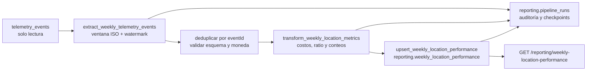

# Diseño del pipeline de desempeño de negocio

## Estado Actual

El backend `services/brasaland-api` expone `POST /telemetry/events`. El receptor valida el envelope y las propiedades mediante allowlists y escribe en `public.telemetry_events` de Supabase en lotes. La tabla actual conserva `timestamp`, `service`, `event_type`, `value`, `message` y `tags` (las propiedades del evento). No persiste `eventId` ni `requestId`, y el escritor actual inserta filas sin deduplicación. Por tanto, el almacén todavía no permite reconstruir ni deduplicar de forma fiable el envelope completo.

El registro `docs/telemetry/event-schemas.json` contiene los eventos de inventario obligatorios. Las operaciones de inventario siguen siendo futuras/stub: no se deben presentar eventos sintéticos ni las solicitudes de compra en memoria como actividad real. El contrato de `inbound_order_created` ya tiene `quantity`, `unit_price` y `currency`. Para habilitar el KPI de merma, esta entrega agrega `unit_cost` no negativo y requerido a `stock_waste_registered`; el receptor lo valida mediante su allowlist.

El brief de esta fase describe un reporte técnico de telemetría para ingeniería (volumen, errores y latencia) que debe permanecer intacto. En el checkout actual no encontré `services/telemetry/analysis.py` ni una ruta `GET /telemetry/report`: existe el receptor, no ese reporte. La brecha de negocio sigue siendo la misma: ni el receptor ni ese reporte técnico consolidan cuánto cuesta comprar o perder producto por local, ni cuentan quiebres y alertas de precio por semana. Este documento no crea ni modifica el reporte técnico.

## Propósito y alcance

**Propósito:** producir cada lunes el **Reporte Semanal de Costo y Merma por Local** para Mariana Restrepo y Felipe Guerrero, calculando costo de compra, costo de merma, ratio de merma, frecuencia de quiebres de stock y alertas de precio desde `inbound_order_created`, `stock_waste_registered`, `stock_threshold_triggered` e `ingredient_price_variance_detected` (con `outbound_order_created` solo como señal de volumen y calidad, no como KPI).

La salida de v1 es `reporting.weekly_location_performance`, con una fila por `location_id` y semana ISO; no convierte COP/USD. `telemetry_events` es fuente de solo lectura para el pipeline y nunca su destino. La extensión `unit_cost` cambia únicamente el payload permitido de un evento existente para hacer calculable la merma monetaria.

## Extracción y transformación

La extracción consulta `public.telemetry_events` por `event_type` y por `timestamp` UTC en intervalo semiabierto `[week_start, week_start + 7 días)`. El contrato de eventos entrega JSON: `event_type`, `timestamp` y `properties` en `tags`; allí están `location_id`, `country`, `quantity`, `unit`, `currency` e IDs de orden/producto. `requestId` y `eventId` forman parte del envelope de captura, pero la tabla/escritor actuales no los persisten. Antes de implementar el pipeline, la ingesta deberá preservarlos y deduplicar por `eventId` (ver Idempotencia).

La captura batch de compras llega con cadencia objetivo de 15 minutos; quiebre de stock y alertas de precio se diseñaron como stream, y el evento de merma se entrega por lotes cada 15 minutos. La corrida programada recalcula la última semana ISO completa el lunes antes de las 07:00, hora `America/Bogota`; verifica frescura y cobertura antes de publicar. Si la extracción no puede probar cobertura suficiente, la corrida queda `Failed` o `Incomplete`, nunca interpreta un fallo de captura como actividad cero.

Transformación por local y semana:

- `total_purchase_cost = sum(quantity * unit_price)` para `inbound_order_created`.
- `total_waste_cost = sum(quantity * unit_cost)` para `stock_waste_registered`.
- `waste_ratio = total_waste_cost / total_purchase_cost`; es `0` si no hubo compras.
- `stockout_events_count` cuenta `stock_threshold_triggered` una vez por `eventId`.
- `price_alert_events_count` cuenta `ingredient_price_variance_detected` una vez por `eventId`.
- `currency` se deriva y valida por local: `CO` usa `COP`, `US` usa `USD`. Un evento cuya combinación local/país/moneda no coincida se rechaza a cuarentena y se registra el error; no se mezclan ni convierten monedas.

Los 14 identificadores canónicos del contrato son `COL-01`–`COL-10` y `FLA-01`–`FLA-04`; la relación con país/moneda debe validarse desde el catálogo canónico de locales (o una configuración versionada mientras no exista tabla de locales). Se emite una fila por los 14 locales, también cuando sus valores de actividad son cero, solo después de confirmar que la extracción y la captura estuvieron sanas. Un local sin eventos con cobertura desconocida no se presenta como cero confirmado.

## Flujo de datos



## Destino y API planeada

El destino de negocio conserva exactamente la tabla y clave de negocio indicadas por el contexto:

```sql
create table reporting.weekly_location_performance (
  id uuid primary key default gen_random_uuid(),
  location_id text not null,
  country text not null,
  week_start date not null,
  total_purchase_cost numeric not null default 0,
  total_waste_cost numeric not null default 0,
  waste_ratio numeric not null default 0,
  stockout_events_count integer not null default 0,
  price_alert_events_count integer not null default 0,
  currency text not null,
  computed_at timestamptz not null default now(),
  unique (location_id, week_start)
);
```

Para auditar y servir estado se propone además `reporting.pipeline_runs`, separado del agregado: `run_id uuid` (clave), `flow_name text`, `trigger_type text`, `week_start date`, `status text`, `phase text`, `started_at timestamptz`, `ended_at timestamptz`, `source_counts jsonb`, `source_min_timestamp timestamptz`, `source_max_timestamp timestamptz`, `source_watermark timestamptz`, `output_rows integer`, `error_code text` y `error_message text` saneado. No guardar payloads crudos, secretos ni datos personales en el log. La tabla de corridas no reemplaza ni altera el esquema indicado para el agregado.

El módulo futuro será `services/reporting/`, distinto de `services/telemetry/`. La API solo valida permisos, parámetros y dispara/consulta funciones; toda lógica ETL vive en `data/pipelines/`.

| Endpoint | Comportamiento y función llamada |
|---|---|
| `GET /reporting/pipeline-runs/latest` | Lee el estado y metadata más recientes de `reporting.pipeline_runs` mediante `get_latest_pipeline_run()` en `data/pipelines/run_store.py`. |
| `POST /reporting/pipeline-runs` | Solicita una ejecución manual y responde `202` con `run_id`; llama `trigger_weekly_location_performance_flow()` en `data/pipelines/weekly_location_performance.py`. Restringido a rol autorizado. |
| `GET /reporting/weekly-location-performance?week_start=YYYY-MM-DD` | Devuelve todos los locales de la semana solicitada; si se omite, usa la semana ISO completa más reciente publicada. Llama `query_weekly_location_performance()` en `data/pipelines/reporting_store.py`. |

## Idempotencia, fallos y recuperabilidad

**Duplicados en origen.** La clave de evento es `eventId` del envelope, no el timestamp de recepción, `requestId` ni el ID aleatorio de fila que hoy genera Postgres. Es prerrequisito de implementación añadir `event_id` único (y conservar `request_id` y `received_at`) a la persistencia de la ingesta; el endpoint debe usar `eventId` como clave de upsert. Reintentar con el mismo ID devuelve aceptación idempotente; un mismo ID con contenido distinto se rechaza y alerta como colisión. El pipeline deduplica una vez más por `event_id` como defensa. El esquema actual pierde ese campo, por lo que todavía no ofrece esta garantía.

**Fallo parcial en carga.** Se recalcula la semana completa desde la fuente deduplicada y se hace upsert por el constraint `(location_id, week_start)`. Cada conflicto reemplaza todos los campos KPI y `computed_at`, no suma incrementos. Si se cargaron 8 de 14 locales y hubo timeout, el reintento escribe de nuevo esas mismas filas y completa las restantes sin duplicar ni inflar cifras. La publicación de una semana se considera completa solo si el upsert de las 14 filas termina y se registra `Completed`.

**Eventos tardíos.** Se usa `timestamp` de ocurrencia para asignar semana y `received_at` para detectar tardanza. Cada corrida semanal vuelve a calcular la semana recién cerrada y las cuatro semanas ISO anteriores; el mismo upsert reemplaza la cifra publicada y `pipeline_runs` conserva qué ejecución recalculó cada ventana. Eventos más antiguos generan alerta y requieren backfill manual autorizado. Esta ventana es una política v1 revisable con datos reales.

**Checkpoint/retoma.** `pipeline_runs.phase` toma `extract`, `transform`, `load` o `complete`; registra watermark, conteos por tipo, límites de timestamp y salida. Tras caída de BD no se confía en una carga parcial como checkpoint de datos: se reejecuta de forma determinista la semana completa desde extracción. Prefect puede reintentar la tarea de carga con espera exponencial; tras agotar reintentos, guarda `Failed` y el error saneado.

**Concurrencia.** Cada corrida tiene `run_id` único. Prefect limita concurrencia por `week_start` y la carga toma un lock transaccional/advisory por semana; cron y disparo manual concurrentes se serializan. El constraint único de destino es la última protección contra duplicados.

## Log, observabilidad y recuperación operativa

Cada fila de `reporting.pipeline_runs` registra los campos descritos arriba. En particular, inicio/fin permiten medir duración y detectar flows colgados; estado/fase/error explican el resultado y el punto de caída; `source_counts`, watermark y extremos temporales distinguen lote vacío de extracción atrasada; `output_rows` permite verificar las 14 salidas; `trigger_type`, `run_id` y `week_start` identifican quién/qué originó la corrida y qué partición recalculó. Logs estructurados de Prefect correlacionan `run_id`, `eventId` y `requestId` sin guardar el envelope sensible.

1. **Silencio frente a cero:** contar cero solo tras extracción correcta, watermark fresco y control de cobertura por los 14 locales. Un flujo sin corrida reciente, ingestion atrasada o falta de locales reportantes es `Incomplete`/`Failed`, acompañado de heartbeat de la corrida y alerta; no es cero operativo confirmado.
2. **Trazabilidad evento → reporte:** correlacionar `eventId`, `requestId`, `run_id`, ventana ISO, conteos por `event_type` y watermark. Guardar en el artefacto de auditoría de la corrida los IDs procesados o un manifiesto verificable, no payloads crudos; así se reconstruyen huecos, ráfagas y retrasos.
3. **Crecimiento frente a pérdida:** comparar conteos por tipo, locales con eventos y rechazos de captura con las semanas previas equivalentes; contrastar con salud/volumen de `POST /telemetry/events`. Una caída abrupta dispara revisión de cobertura, no una conclusión automática de que el negocio bajó.
4. **Buffer offline:** no depender de `localStorage` como cola de negocio. La fuente de verdad debe persistir la orden y su outbox en servidor; el cliente puede reintentar el mismo evento con el mismo `eventId`, mientras la ingesta deduplica. Un buffer local se pierde, puede editarse y duplica al reconectar.
5. **Reintento de transmisión:** conservar el `eventId` y usar una clave idempotente estable. `2xx` significa almacenado o ya conocido; `503`/timeout es reintentable con backoff; `4xx` de esquema/permisos no se reintenta sin corregir. El receptor actual todavía inserta sin upsert, así que esta semántica es requisito previo, no capacidad ya disponible.

## Prefect: flows, tasks y configuración

- Flow principal: `weekly_location_performance_flow(week_start, trigger_type)` orquesta toda la ventana y escribe el registro de corrida.
- Task `extract_weekly_telemetry_events`: lectura de solo consulta, filtros por tipos/ventana, watermark y conteos de extracción.
- Task `transform_weekly_location_metrics`: deduplicación defensiva, validación de dimensiones/moneda y agregación determinista.
- Task `upsert_weekly_location_performance`: carga idempotente de las 14 filas por clave de semana/local.
- Task `finalize_pipeline_run`: persiste `Completed` o `Failed`, timestamps, fase, conteos y errores saneados.
- States observados: `Running` al adquirir la ventana; `Completed` solo tras confirmar todas las filas; `Failed` ante error no recuperable o cobertura insuficiente. Los reintentos mantienen el mismo objetivo de semana, pero cada intento conserva su propio `run_id` relacionado.
- Schedule: lunes 06:00 `America/Bogota`, con plazo para que la última semana completa esté disponible antes de las 07:00. Las ejecuciones manuales usan el mismo flow.
- Prefect blocks: `SupabaseReportingRead` con URL y credencial de solo lectura para `telemetry_events`; `SupabaseReportingWrite` limitado al esquema `reporting`; `BrasalandPipelineSchedule` para zona horaria/ventanas y política de backfill; y un bloque de alertas. Secretos en blocks/secret manager, nunca en código ni logs. El flow no recibe ni usa una credencial con permiso para escribir en telemetría.

## Decisiones pendientes para pasar a implementación

1. Persistir `eventId`, `requestId` y `received_at` durante la ingesta; implementar upsert idempotente por `eventId`. Hoy el almacenamiento los descarta.
2. Confirmar la fuente de verdad/catálogo que mapea los 14 `location_id` a `country` y `currency`, y cómo el job mide la cobertura de captura. El contrato enumera IDs pero el repositorio no contiene aún un catálogo persistido de locales.
3. Aplicar migraciones para `reporting.weekly_location_performance` y `reporting.pipeline_runs`, con permisos separados de lectura de telemetría y escritura de reporting.
4. Implementar y probar el flow Prefect y el nuevo módulo HTTP `services/reporting/`. Esta fase entrega diseño y contrato aditivo, no ejecución de ETL.
